# DLhook

> _High-throughput apical hook phenotyping of dark-grown Arabidopsis thaliana seedlings_

`v0.3.0` · pre-release · GPL-3.0

**Lead Development:** David Radianu, Adrien Heymans

**Contributors:** Sara Raggi, Siamsa Doyle, Hemamshu Ratnakaram, Sandeep Yadav

**Coordination:** Stéphanie Robert, Adrien Heymans


---

## What DLhook does

`DLhook` measures the apical hook angle of dark-grown *Arabidopsis thaliana* seedlings across an image time series, replacing the tedious work of measuring each hook by hand.

The pipeline has four stages:

1. **Segmentation.** A U-Net with group normalisation and residual connections (`UNetGNRes`, PyTorch) segments each cropped seedling into **cotyledon** and **hypocotyl** (thin overlays to judge the reading against, plus the hypocotyl mask that length, curvature and diameter are measured on). A separate learned detector finds **germination** (the emerging radicle), which fixes time zero for each seedling independently; the radicle itself is no longer segmented. Earlier versions ran three separate two-class models and fitted ellipses; both paths are retained and can still be selected — see [Which segmentation models run](#which-segmentation-models-run) and [Which angle method runs](#which-angle-method-runs).
2. **Geometry.** For every frame, an ensemble of three landmark networks reads the cotyledon/hypocotyl **junction** and the direction of each axis directly from the crop, then computes the angle between them (`raw_angle`). On the hypocotyl mask DLhook also measures its length, curvature and diameter.
3. **Temporal reconstruction.** Each seedling's frames are read as one series: frames with no usable information are rejected, readings far from their neighbours are discarded, the rest is lightly smoothed, short gaps are interpolated, and every frame gets a biological angle (`bio_angle`) and a state (`Closed` / `Opening` / `Unreadable`). Frames whose collar or junction breaks the way a seedling grows are flagged for review.
4. **Review and export.** Every seedling can be inspected frame by frame and its landmarks placed by hand before the results are written to a `.CSV`.

The network architecture and the trained weights derive from [RootPainter](https://github.com/Abe404/root_painter). Inference runs on [PyTorch](https://pytorch.org/).

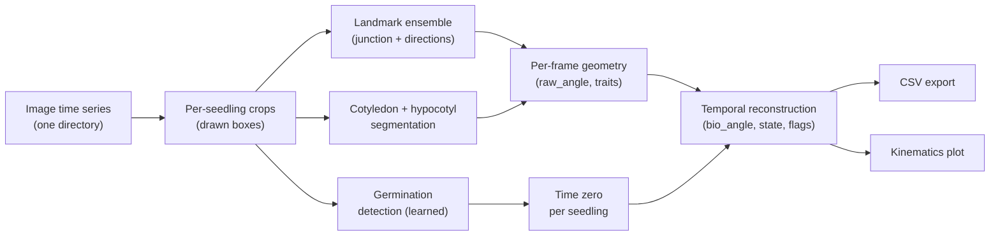

---

## Installation

### 1. Clone the repository

```bash
git clone https://github.com/SRobertGroup/DLhook/
cd DLhook
```

### 2. Create the environment

> [!NOTE]
> We recommend [Mamba](https://mamba.readthedocs.io/en/latest/installation/mamba-installation.html) for creating the virtual environment ([Anaconda](https://www.anaconda.com/download) works too).
>
> For more on setting up conda, see the [conda user guide](https://conda.io/projects/conda/en/latest/user-guide/install).

The maintained path is the environment file, which pins Python 3.10 and installs the pinned packages of `requirements.txt` with a CUDA 12.8 build of PyTorch. Run it from the repository root:

```bash
mamba env create -f env.yaml
mamba activate dlhook_env
```

Every package has an exact version. `requirements-lock.txt` pins the full environment, transitive packages included (`pip install -r requirements-lock.txt` reproduces it), and `requirements-dev.txt` adds `pytest`.

<details>
<summary>Alternative: build the environment by hand</summary>

```bash
mamba create -n dlhook_env python=3.10 -y
mamba activate dlhook_env
```

For **GPU** (CUDA), take PyTorch from the PyTorch index. The pins match the `2.8.0+cu128` build; use `cu126` for an older driver:

```bash
pip3 install --no-cache-dir --extra-index-url https://download.pytorch.org/whl/cu128 -r requirements.txt
```

For **CPU only**:

```bash
pip3 install --no-cache-dir -r requirements.txt
```

</details>

Dependencies, all pinned (see [`requirements.txt`](requirements.txt) and [`env.yaml`](env.yaml)): `torch`, `torchvision`, `numpy`, `pandas`, `pillow`, `matplotlib`, `scikit-image`, `opencv-python`, `PyYAML`, `tqdm`, `basicsr` and `realesrgan`.

> [!TIP]
> A GPU is optional but strongly recommended — segmentation is roughly **8× faster** on CUDA. Match the CUDA version to your driver; `env.yaml` installs the CUDA 12.8 build, which recent GPU generations (Blackwell) need; change `cu128` to `cu126` for an older driver. DLhook checks that CUDA actually works (a tiny test operation) before using the GPU and falls back to the CPU with a warning when it does not; `DLHOOK_DEVICE=cpu` forces the CPU.

### 3. Start DLhook

```bash
python main.py
```

> [!NOTE]
> You have to activate the environment (`mamba activate dlhook_env`) each time before launching the application.

### Model weights

The default pipeline needs the files below. **They are not in git**: they are deposited on Zenodo ([doi:10.5281/zenodo.23531884](https://doi.org/10.5281/zenodo.23531884)). Download them into the repository with

```bash
python -m utils.fetch_weights          # the files below
python -m utils.fetch_weights --all    # also the fallback and legacy files
```

Every file is checked against a pinned SHA-256, and a file that is already there is never replaced. Alternatively, download the zip from Zenodo, unzip it and copy its `weights/` folder into the repository. Nothing is downloaded when DLhook starts.

| File | Provides | Used for |
|---|---|---|
| `weights/landmarks/dlhook_landmarks_m_{a,b,c}.pt` | landmark ensemble (three members, with the measurable output) | the hook angle, junction and axis directions, and the readability gate |
| `weights/multiclass/dlhook_4class_v2.pt` | cotyledon + hypocotyl | the overlays, and the mask the length, curvature and diameter are measured on |
| `weights/multiclass/dlhook_4class_v1.pt` | cotyledon + hypocotyl + radicle | the learned germination detector (fitted on this model) |
| `weights/germination_detector.json` | learned germination detector | per-seedling time zero (it reads `dlhook_4class_v1.pt`) |

**When a file is missing DLhook falls back, with a warning in the console, instead of failing:**

- no `dlhook_landmarks_m_*.pt` but the previous `dlhook_landmarks_{a,b,c}.pt`: those are used, gated by the logistic rule below;
- no landmark weights at all: the angle comes from the legacy ellipse fit (see below);
- no `dlhook_4class_v2.pt` but `dlhook_4class_v1.pt`: v1 is used for the overlays and the traits;
- neither four-class checkpoint: the legacy three binary models run for segmentation;
- no `weights/germination_detector.json` (or no `dlhook_4class_v1.pt`): germination is **unknown**. `germination_frame` is an empty cell and time zero stays unset. Set the frame by hand in the analysis window if you need it.

Results therefore differ between machines that do not hold the same files: check the console for `WARNING` lines before comparing runs.

The legacy paths use the three two-class RootPainter models (`cotyledon_v5.pkl`, `hypocot_v5.pkl`, `germ_v1.pkl`, all in [`weights/RootPainter_weights/`](weights/RootPainter_weights/)).

A further model, Real-ESRGAN (`models/superres/RealESRGAN_x4plus.pth`), can super-resolve crops on CUDA, but it is **off by default** (`DLHOOK_SUPERRES=1` turns it on): the landmark models were built on plain crops, and super-resolved crops raised their validation error from 20.6 to 34.3 degrees. The 64 MB file is not in the repository: it is downloaded from the official Real-ESRGAN release on first use and checked against a pinned SHA-256 (`models/superres/weights_info.py`); a file already at that path is used as is.

### Which angle method runs

Set `DLHOOK_ANGLE_SOURCE` before launching to choose:

| Value | Behaviour |
|---|---|
| `landmarks` *(default)* | Three landmark networks (`dlhook_landmarks_m_{a,b,c}.pt`, flip-averaged) read the junction and the hypocotyl and cotyledon directions on the plain crop. |
| `ellipse` | The legacy method: ellipses fitted to the cotyledon and hypocotyl masks. |

```bash
DLHOOK_ANGLE_SOURCE=ellipse python main.py     # legacy ellipse method
DLHOOK_LANDMARK_GATE=0 python main.py          # keep every landmark reading (no readability gate)
```

On the BerryBox v2 test set (six image series, Camera_2 to Camera_5 and Plates 2 and 3: 326 hand-measured frames of 81 plants no model had seen) the landmark ensemble has a mean error of **15.0°** (median **6.9°**). On the 287 frames of the first five series, the ellipse pipeline's error is **26.8°**. Repeating a measurement by hand differs by **4.2°** on average (5.0° between two blind passes over dense series). The landmark angle is a folded angle, `180 - theta`; the automatic overhook flag is exported separately and does not change `bio_angle`. Landmarks are read from the plain crop, so they need no segmentation mask: an angle exists even where a mask is empty.

**Readability gate.** The ensemble reads an angle on every frame, including frames with no usable information (the ones an annotator would skip). A gate rejects such frames:

- a rejected frame gets no angle (`bio_angle` empty, state `Unreadable`) and is never interpolated across;
- the analysis window still shows the rejected reading, in grey, and placing the landmarks by hand overrides the gate;
- `DLHOOK_LANDMARK_GATE=0` disables it (every frame keeps its reading; `unreadable_p` is still exported).

The gate is a learned **measurable** output of the landmark networks: an image-level head trained on the frames annotators measured and the ones they skipped (`measurable_p` is exported). On BerryBox v2 it rejects 76% of the skipped frames while keeping 98% of the measured ones. With the previous landmark weights, which lack that output, the gate is a logistic rule on the junction peak, the cotyledon-tip peak and the disagreement between the three networks (68% rejected, 99% kept).

**Series filter.** Single readings jump: about 13% of per-frame readings sit more than 20° away from their neighbours, mostly for 1 to 3 frames (a cotyledon axis read the wrong way round, for instance). Each seedling's series is therefore cleaned before states are assigned:

- a reading more than 45° away from the median of itself and its 3 readable neighbours on each side is **rejected** (it becomes a gap, filled by interpolation when the gap is at most 3 frames);
- the remaining readings are smoothed by a running median of 3;
- frames you set by hand are never changed, and they anchor their neighbours;
- `raw_angle` keeps the model's reading and `series_edit` says what the filter did (`rejected` / `interpolated`); the analysis window names a rejected reading, and `A` accepts it.

The settings were chosen on dense hand-measured series of 9 BerryBox v2 seedlings (every frame measured) and tested on 7 other dense series and on 67 other plants measured sparsely. The mean error fell from 14.9° to 14.3° and from 16.7° to 13.6° on these two test sets, and the share of frames off by more than 20° from 18% to 16% and from 17% to 15%. Readings far from their neighbours dropped from 13% to 3% of frames (`python -m multi.tune_series`, `python -m multi.evaluate_series`).

**Time-series checks.** Two facts of a growing seedling are checked across each seedling's frames:

- the collar barely moves (median 2.6 px between annotated frames);
- the junction moves away from the collar as the hypocotyl elongates (the distance grew in 99.7% of 737 annotated frame pairs).

A frame is **flagged, not changed**, when its collar jumps away from the seedling's stable collar (by more than 15 px, or more than a quarter of the junction–collar distance), or when its junction moves back toward the collar by more than 5 px. A flagged frame is drawn in amber in the analysis window, with the seedling's usual collar as a hollow ring and a one-line explanation; its point gets a black ring in the kinematics plot; and the export names the check in `temporal_flag`. A manual edit is trusted and clears the flag.

### Which segmentation models run

Set `DLHOOK_SEG_BACKEND` before launching to choose:

| Value | Behaviour |
|---|---|
| `multiclass` *(default)* | Four-class model (`dlhook_4class_v2.pt`, else v1) for cotyledon and hypocotyl: the overlays and the mask the hypocotyl traits use. No radicle mask: germination comes from the learned detector. Falls back to `binary` when neither four-class checkpoint is present. |
| `binary` *(legacy)* | Three two-class models: `cotyledon_v5.pkl`, `hypocot_v5.pkl`, `germ_v1.pkl`, unchanged from earlier versions. |

```bash
DLHOOK_SEG_BACKEND=binary python main.py     # legacy three-model path
```

With no radicle mask the area-rule germination fallback is unavailable: when the learned detector cannot run, germination is reported as **unknown** (empty cell, with a warning) rather than guessed. The value is read once when the application starts, so it cannot be changed part-way through a session: one set of results can never mix output from two different models. An unrecognised value stops the program with an error rather than silently falling back.


---

## Input data

The input is a single directory holding one time series:

```
images_folder
   |-- Col0_001.tif
   |-- Col0_002.tif
   |-- ...
```

**Accepted extensions:** `.tif`, `.tiff`, `.png`, `.jpg`, `.jpeg`, `.bmp` (any case).

**Frame ordering.** DLhook orders the series by the **capture time embedded in each file** (EXIF sub-IFD `DateTimeOriginal` / `DateTimeDigitized`, or TIFF tag 306), taking the earliest timestamp present. It falls back to the first integer found in the filename only when the embedded times are missing or unusable. Filesystem creation and modification times are deliberately **not** used — they are frequently identical across a whole series and therefore meaningless as an ordering key.

If the timestamps cannot be trusted — any frame missing one, or the series not strictly increasing — DLhook asks once for the **interval between images in minutes** (dialog: *No usable capture times*) and builds the time axis from that. ImageJ-exported TIFFs typically carry no timestamp at all and will always prompt.

---

## Workflow

Load a directory, draw one box per seedling, and run the analysis. The sidebar is grouped as **Images**, **Seedlings**, **Analysis** and **Settings**; the window and the canvas can be resized.


**A full run at a glance** (screenshots of a run on the plate `F1_Plate_3_YS`, 26 seedlings x 50 frames, with a scale set; each step is detailed below):

| Step | What you do | Screenshot |
|---|---|---|
| 1 | `Open image directory` and pick the folder of one time series | [series loaded](docs/img/workflow/02_series_loaded.png) |
| 2 | Draw one box per seedling (or `Load boxes…`) | [crop boxes](docs/img/workflow/03_crop_boxes.png) |
| 3 | Optional: `Calibrate scale…` for millimetre columns | [scale calibration](docs/img/workflow/04_scale_calibration.png) |
| 4 | `Start Analysis` | [running](docs/img/workflow/05_analysis_running.png), [done](docs/img/workflow/06_analysis_complete.png) |
| 5 | `Preview seedling`: review each seedling, correct frames | [picker](docs/img/workflow/07_seedling_picker.png), [review window](docs/img/workflow/08_seedling_window.png), [filtered reading](docs/img/workflow/09_seedling_window_flagged.png), [unreadable frame](docs/img/workflow/09_seedling_window_flagged_unreadable.png), [manual landmarks](docs/img/workflow/10_manual_landmarks.png) |
| 6 | `Show kinematics` | [kinematics](docs/img/workflow/11_kinematics.png) |
| 7 | `Export results` | [export done](docs/img/workflow/12_export_done.png), [the CSV](docs/img/workflow/12b_export_csv.png) |

The screenshots are regenerated by `python docs/make_screenshots.py`, which drives the real GUI on an example series (see its docstring).

### Loading the series

Click **`Open image directory`** and select the folder containing one time series. The frames appear in the list, in acquisition order, and the last frame is shown at its native resolution. Select any other frame in the list to display it; the boxes and the zoom stay where they are. Opening another folder starts a new series (you are asked first if that would discard boxes or results).

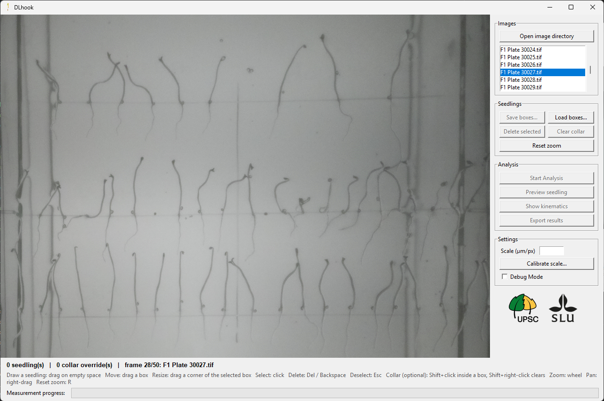

### 1. Draw the crop boxes

Work on the **last frame** of the series, where the seedlings are most developed. The canvas works like `python -m multi.draw_crops`:

| Action | Result |
|---|---|
| **Drag** on empty space | Draw a seedling: drag over its visible extent (seed coat to hook tip). The padded crop box is shown live and is the box that is stored. |
| **Drag** a box | Move it. |
| **Click** a box | Select it. Drag a **corner handle** of the selected box to resize it. |
| **`Delete`** / **`Backspace`** (or `Delete selected`) | Delete the selected box. |
| **`Esc`** | Deselect. |
| **Mouse wheel** | Zoom at the cursor. **Right-drag** (or middle-drag) pans, **`R`** (or `Reset zoom`) fits the whole image. |

- **Boxes are highlighted, not trimmed, when they overlap.** Overlapping boxes are outlined in **magenta** and the status line below the canvas names them (for example `OVERLAP: 2 & 3`). Boxes are clamped to the image.
- **Each box shows its seedling ID** in its top-left corner. IDs are numbered across the plate **top-to-bottom, then left-to-right**, and renumbered whenever a box is added, moved or removed. This number is the `seedling_id` in the exported CSV and the number in *Preview seedling*. If results already exist, changing a box asks for confirmation and then clears them, because the results are tied to the box numbers.
- The status line also shows the number of seedlings, the number of collar overrides and the current frame.

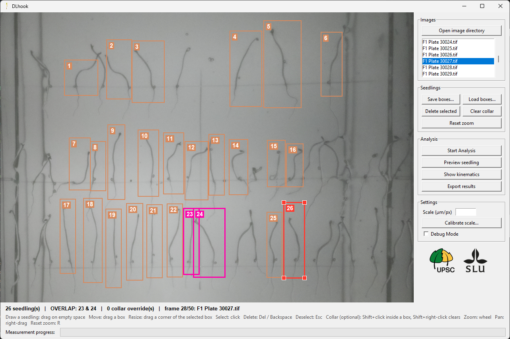

### 2. Optional collar, save and load boxes

**Collar (optional).** Everything below the seedling's collar (the seed coat or root side) can be cut off from the masks. By default DLhook uses the collar that the landmark model finds in each frame, and masks nothing when it finds none. To fix the collar of one seedling yourself, **Shift+click inside its box**: a purple dot marks it (Shift+drag moves it; the dot travels with the box). **Shift+right-click** inside the box, or `Clear collar`, removes the override. Collar overrides apply to every frame of that seedling.

**Save boxes… / Load boxes….** The boxes are saved as JSON in the format of `multi/draw_crops.py` and `multi/recrop_plates.py`, keyed by the image folder name, with the optional collar as `"collar": [x, y]` in image pixels:

```json
{"plate_one": [{"cx": 428, "cy": 783, "half_w": 120, "half_h": 90, "collar": [430, 850]}]}
```

Saving to an existing file replaces only this folder's entry. When loading, the series named like the open folder is used; a file with a single series is used as is; otherwise you are asked which series to load.

### 3. `Start Analysis`

Runs segmentation and the landmark ensemble across every frame and every crop, then computes the per-frame angles and hypocotyl traits. Progress is shown in the bar at the bottom of the window: cropping occupies the first 30%, segmentation and angle computation the remainder.

When it finishes, the analysis window opens on the first frame that needs a human look, and the status says how many there are (see [Reviewing flagged frames](#reviewing-flagged-frames) below). With nothing flagged, it reads *"Analysis complete -- nothing flagged; Preview seedling to check, or Export results"*.

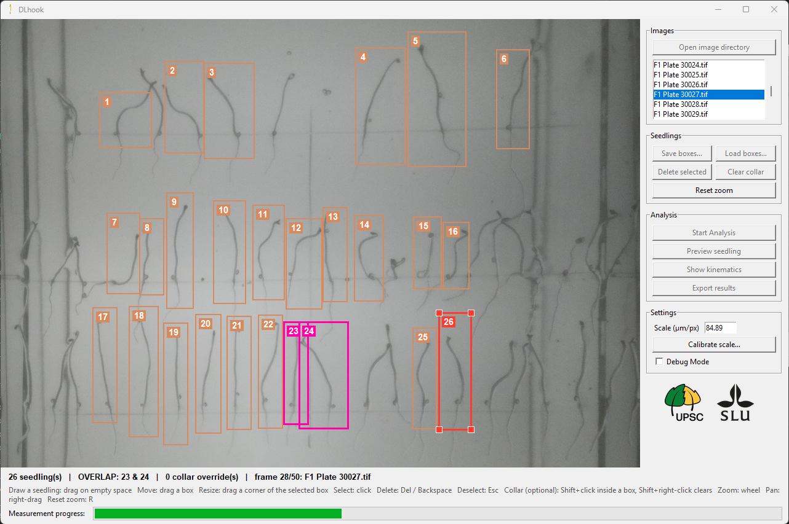

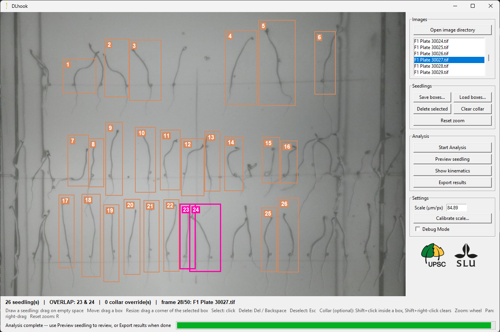

### 4. `Preview seedling`

Opens a picker; choose a seedling to open its **`Seedling N - analysis`** window. This is where all reviewing and correcting happens.

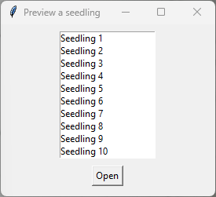

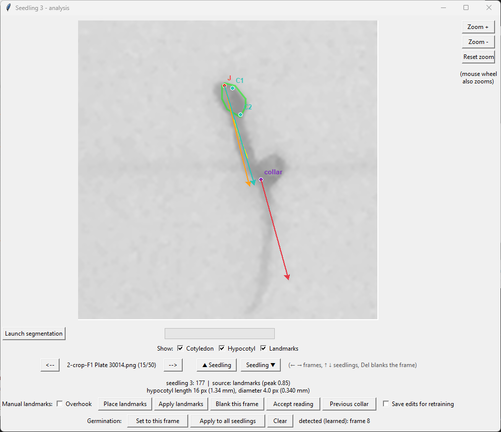

**Viewing**
- `Launch segmentation`: only needed if this seedling has not been segmented yet. Re-segmenting replaces the seedling's results, so you are asked first when it holds manual frames.
- `Show:` `Cotyledon` (green alpha contour) · `Hypocotyl` (yellow smoothed midline) · `Landmarks` (junction, axes and arrows of the current reading, model or manual) · `Collar` (the collar and root arrow of the reading; untick it to see the hypocotyl base unobstructed) · `Germination` (magenta contour, off by default; only shown with the legacy `binary` backend, which still segments the radicle).
- `<--` / `-->` step through frames.
- `Zoom +` / `Zoom -` / `Reset zoom`, or the mouse wheel.

The raw image is shown at full intensity; the overlays are thin lines only, so you can judge the angle against the pixels. There is no mask editing. A reading drawn in **grey** was rejected by the readability gate (the line under the angle gives its unreadable probability, and `A` accepts it as shown); one drawn in **amber** broke a time-series check (see [Which angle method runs](#which-angle-method-runs)) and the line under the angle says which. A reading the series filter rejected is named under the angle (*rejected by the series filter*); `A` accepts it as shown.

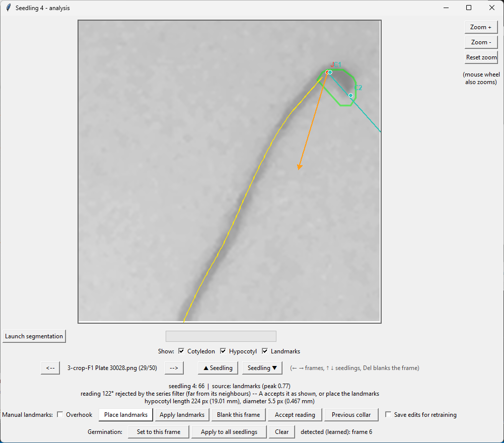

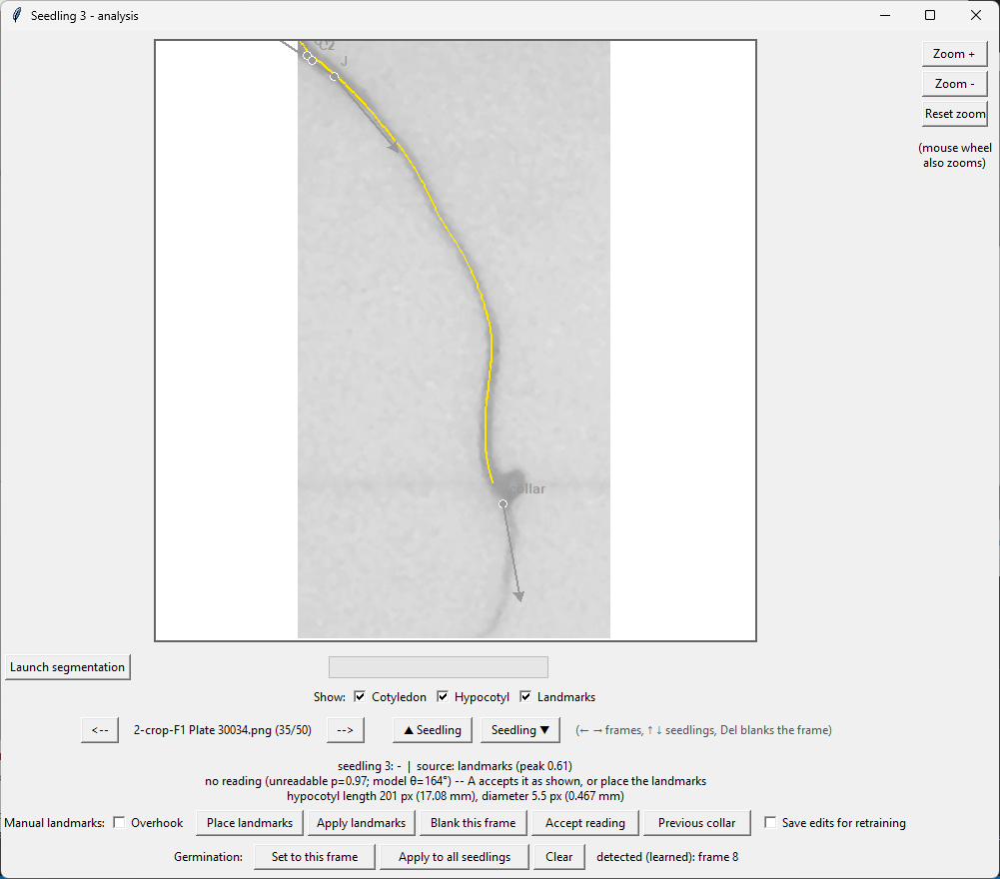

**Overriding the angle by hand (landmarks)**

`Place landmarks`, then click on the image, in this order:

1. **J**: the junction where the cotyledons meet the hypocotyl,
2. **H1**, **H2**: two points on the hypocotyl midline (the axis is oriented away from the junction, so their order does not matter),
3. **C1**: the cotyledon **base**, at the junction,
4. **C2**: the cotyledon **tip** (once the two cotyledons have separated, the midpoint between the two tips),
5. optional **collar**: the hypocotyl/root junction; it ends the length measurement there,
6. optional **root** point: a second point that gives the root direction.

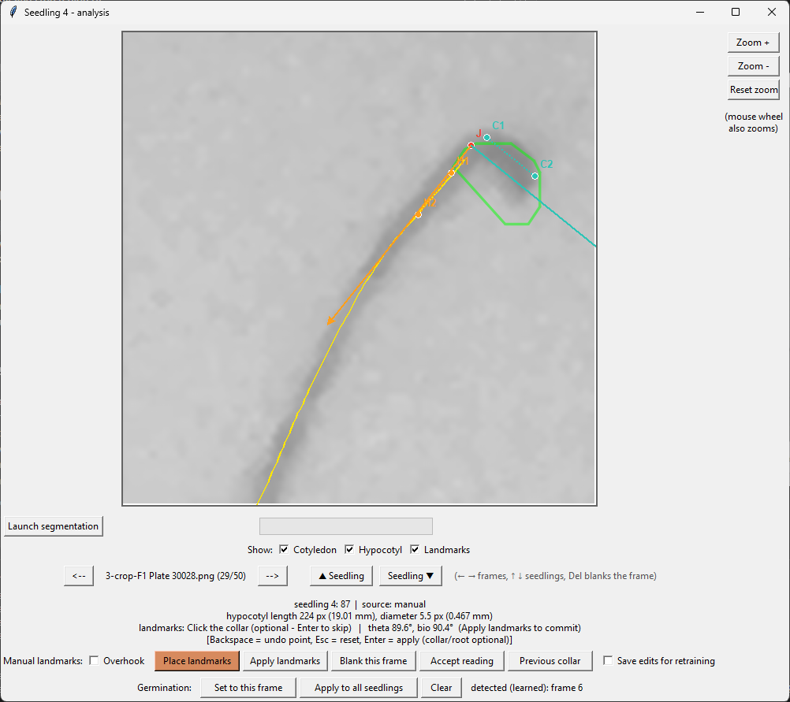

The prompt in the status line names the next click. The angle is complete after C2; `Enter` applies the landmarks (the two optional points can be left out), `BackSpace` undoes the last point and `Escape` resets. Anywhere in the window, `←` / `→` step through the frames and `↑` / `↓` (or the `▲ Seedling` / `Seedling ▼` buttons) open the previous / next seedling at the same frame, in the same place on screen. Once C2 is placed, the `Overhook` box is **ticked automatically** when the cotyledon ray crosses the hypocotyl ray (the same test as for the model's reading); you can still tick or untick it. `Apply landmarks` commits the frame as **Manual** (an overhooked hook is stored as `180 + theta`, otherwise `180 - theta`), recomputes the hypocotyl traits with your collar (or the model's) and re-reconstructs the series around your frame. Applying also leaves click mode, so arrows and the other keys work again at once; with `Save edits for retraining` ticked, click mode stays on for the next correction. Three shortcuts avoid re-clicking a reading that is nearly right:

- **`Accept reading`** (`A`) keeps the model's reading as shown, also a grey one the gate rejected or an amber one a time-series check flagged, and commits it as **Manual** with the model's angle. Use it when the landmarks are right but the frame was greyed out or flagged.
- **`Previous collar`** (`C`) gives this frame the collar of the nearest earlier frame whose collar can be trusted (a Manual frame, or a readable one without a collar flag). The angle is unchanged; the hypocotyl length and the time-series flags follow the new collar. Use it when only the collar jumped.
- **`O`** (the `Overhook` box does the same) keeps the model's landmarks and applies the overhook to the angle (`180 + theta`); press it again to remove it. The line under the angle always says which one is in force: *overhook applied*, *overhook not applied*, or *the model suggests an overhook, not applied* when the cotyledon ray crosses the hypocotyl ray, with the angle each choice gives. The box follows the frame you are on. While you place landmarks, `O` only ticks or unticks the box.

All three count as edits: the kinematics plot redraws, and with `Save edits for retraining` ticked an accepted reading is saved as a training record.

`Blank this frame` discards the frame's measurement entirely — use it when the seedling has rotated so the cotyledon sits in front of or behind the hypocotyl, since a 2D image cannot yield a correct angle in that case. A blanked frame's reading stays drawn in grey, like a frame the gate set aside; placing landmarks on it gives it an angle again.

<a id="reviewing-flagged-frames"></a>**Reviewing flagged frames.** The frames that need a human are collected in a review queue across all analysed seedlings: readings the series filter rejected (*spike*) and readings a time-series check flagged (*collar*, *junction*). The `To review:` row at the bottom of the analysis window shows where you are (*3 of 27: spike*); `Next ▶` / `◀ Previous` (keys `N` / `P`) jump to the next queued frame, opening the next seedling when needed. Any edit on a frame (`Apply landmarks`, `A`, `Del`) marks it reviewed and removes it from the queue; `C` fixes only the collar, so the frame stays queued until its flag clears or you accept it with `A`. Frames the readability gate set aside are not queued by default, since most of them cannot be measured; tick `Include unreadable` to go through them as well. `Review flagged frames` in the main window reopens the queue at its first frame.

**Saving corrections for retraining.** Tick `Save edits for retraining` (you are asked for a folder once). Each `Apply landmarks` then writes a JSON record (the clicked points, the overhook tick, the model reading it replaced) and a copy of the crop to that folder. Convert the records into annotation CSVs and a crop folder that the landmark training code reads with

```bash
python -m multi.edits_to_csv path/to/landmark_edits --out-prefix data/annotations/angles/angle_edits --crop-dir data/crops/cropped_edits
```

and add the result to `landmarks.extra_sources` in the training config (see [Training a landmark head](#training-a-landmark-head-from-your-annotations)). A frame edited twice keeps its latest record.

**Germination**
- The detected frame is shown; `Set to this frame` overrides it, `Apply to all seedlings` propagates it, `Clear` removes it.


### 5. `Show kinematics`

Plots angle against time for all seedlings at once. Time is measured **since germination**, in hours when timestamps are available, otherwise in frames.

The legend gives the **State** (marker colour: Closed, Opening, Manual, Unclassified); a black ring marks a **temporal flag**. `Unreadable` frames have no angle and are not plotted. Each seedling has its own line colour; clicking a point opens that seedling at that frame. A **dashed** line means no germination frame was found for that seedling, so its time axis is not aligned to the others. The grey horizontal line marks 180° — a fully closed hook.

**Fitted curves.** With `Fitted curves` ticked (the default), each seedling also gets a thicker line in its own colour: a curve fitted to its angles from germination on, which describes the closing, the maintenance and the opening of the hook. Four shapes are fitted, and the simplest one the data support is kept (by BIC):

| Shape | When it is chosen |
|---|---|
| double (closing, then opening) | the hook forms, stays closed, then opens |
| opening only | the hook is already closed when first seen |
| closing only | the hook closes and does not open within the series |
| flat | no transition |

The fit uses the filtered angles, gives Manual frames double weight and is robust to a remaining run of misread frames. It is **descriptive only**: it never changes `bio_angle`, the states or the filter. In a seedling's analysis window, the `Kinetics fit:` row shows the chosen shape, the phase times and the fitted angle at the current frame, and lets you force a shape (`auto` returns to the automatic choice).

The plot redraws by itself when you change a seedling in its analysis window (applied landmarks, a blanked frame, a germination frame, a re-segmentation, a forced kinetics shape). Click `Refresh` after a new *Start Analysis* or *Export results* run. Opening it again brings the same window to the front.


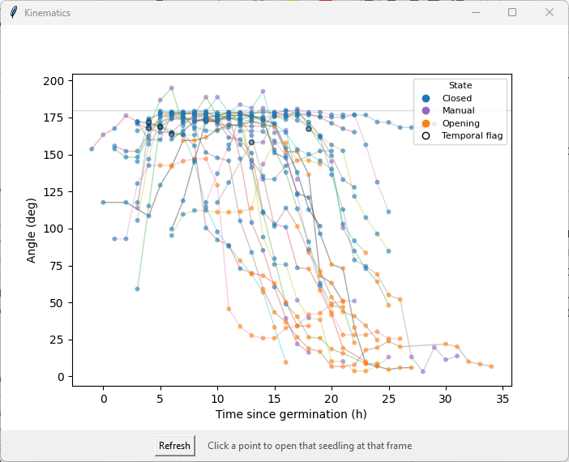

### 6. `Export results`

Choose a destination and DLhook writes the `.CSV`. Any seedling never opened in step 4 is segmented now, so exporting is safe even if you only reviewed a subset. Germination detection and temporal reconstruction run as part of the export.

**Physical scale (optional).** Before exporting, type the image scale in **`Scale (µm/px)`** in the sidebar, or click **`Calibrate scale…`**, click the two ends of an object of known length on the first frame (a ruler, a grid square) and enter its length in mm. The scale is kept for the session. Without a scale the CSV holds pixel values only; with one it gains the `*_mm` columns below.

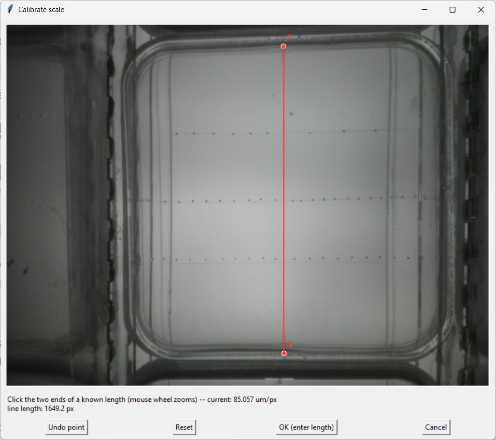

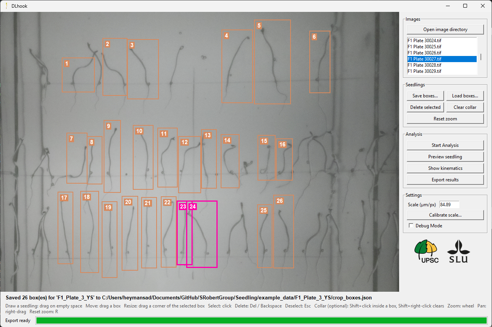

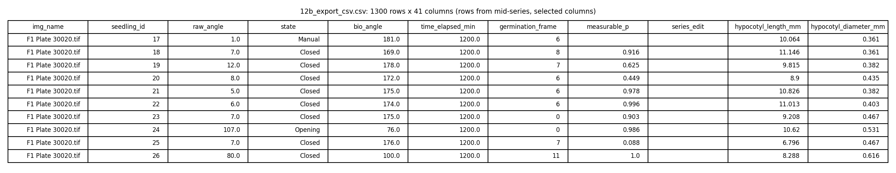

---

## Output

The exported CSV is in **long format** — one row per seedling per frame. The first seven columns are unchanged from earlier versions and keep their order; the landmark and hypocotyl columns follow them.

| Column | Description |
|---|---|
| `img_name` | source image filename |
| `seedling_id` | seedling number, 1-based |
| `raw_angle` | the unmodified per-frame geometric reading, for auditing |
| `state` | `Closed`, `Opening`, `Manual` (a hand-placed angle), or `Unreadable` (landmark frame rejected by the readability gate: no angle) |
| `bio_angle` | the reconstructed biological angle — **use this one** |
| `time_elapsed_min` | time (min) |
| `germination_frame` | frame at which germination of the seedling was detected (empty when unknown) |

**Landmark columns.** All positions are in **crop pixels**, in the pixel frame of that seedling's crop (origin top-left, x to the right, y down). Directions are **unit vectors** in the same image coordinates (y down). Cells are empty when the value does not exist for that frame (for example `collar_*` when no collar was found or clicked).

| Column | Description |
|---|---|
| `angle_source` | `landmarks` or `ellipse`: the method that produced the reading |
| `landmark_edit` | `model` (the network's reading) or `manual` (placed in the analysis window) |
| `landmark_peak` | strength of the junction heatmap peak |
| `overhook_flag` | 1 when the cotyledon ray crosses the hypocotyl ray (overhooked), else 0. It is informational: **it does not change `bio_angle`**, which stays `180 - theta` (a manual edit with `Overhook` ticked stores `180 + theta`) |
| `unreadable_p` | probability that the frame carries no usable information (readability gate; empty for manual frames) |
| `unreadable` | 1 when the gate rejected the frame (then `bio_angle` is empty and `state` is `Unreadable`), else 0 |
| `measurable_p` | the learned head's probability that an annotator could measure this frame (empty with models that lack the head) |
| `temporal_flag` | `collar`, `junction` or `collar+junction` when the frame broke a time-series check, else empty. Flag only: the angle is kept |
| `series_edit` | `rejected` when the series filter discarded this frame's reading (far from its neighbours; `bio_angle` is then interpolated or empty), `interpolated` when a missing frame was filled, else empty |
| `junction_x`, `junction_y` | the cotyledon/hypocotyl junction |
| `hypo_dir_x`, `hypo_dir_y` | direction of the hypocotyl axis, away from the junction |
| `cotyl_dir_x`, `cotyl_dir_y` | direction of the cotyledon axis, base to tip |
| `cotyl_base_x`, `cotyl_base_y`, `cotyl_tip_x`, `cotyl_tip_y` | cotyledon base and tip |
| `collar_x`, `collar_y` | hypocotyl/root junction (collar), when available |
| `collar_ref_x`, `collar_ref_y` | the seedling's stable collar around this frame (rolling median), the reference of the collar check |
| `root_dir_x`, `root_dir_y` | root direction, when available |

**Hypocotyl traits** (measured on the four-class model's hypocotyl mask; empty when there is no mask or no junction):

| Column | Description |
|---|---|
| `hypocotyl_length_px` | length in pixels, from the junction to the collar along the midline (skeleton path) of the hypocotyl mask. With no collar it runs to the end of the mask |
| `hypocotyl_length_truncated` | `True` when there is no collar and the midline touches the crop border, so the length is a lower bound |
| `hypocotyl_curvature_mean`, `hypocotyl_curvature_max` | mean and maximum of the absolute curvature \|κ\| of the smoothed midline, in 1/px (the first and last 5 px are dropped). **Experimental, not validated:** it reads about twice a coarse hand estimate (11 clicks per hypocotyl), which cannot tell the pipeline's error from the reference's |
| `hypocotyl_diameter_px` | diameter in pixels: the median width of transects perpendicular to the midline, taken every 5 px along its inner 80% |
| `fit_angle` | the seedling's fitted kinetics curve at this frame (see *Fitted curves* in step 5); empty before germination and outside the fitted span |

**Kinetics file.** Next to the CSV, `<name>_kinetics.csv` holds one row per seedling: the chosen shape (`model`, `forced` when you set it by hand), the number of frames used, the time unit (`h` since germination, or `frame` without timestamps) and the germination frame it counts from, then the phase times and durations:

- `closing_start`, `closing_mid`, `closing_end`, `closing_duration` and the same four for the opening. A phase starts and ends at 10% and 90% of its change.
- `maintenance_duration`: from the end of closing to the start of opening. It is **negative** when the two overlap, i.e. the hook starts opening before it has fully closed.
- `peak_time`, `peak_angle`: the highest point of the fitted curve. It is lower than the closed plateau when the phases overlap.
- `extrapolated`: the phase limits that fall outside the observed frames, for example `opening_end` for a hook still opening at the last frame. Treat those values as estimates.

**Millimetre columns**, written only when a scale is set: `hypocotyl_length_mm`, `hypocotyl_diameter_mm`, `hypocotyl_curvature_mean_per_mm`, `hypocotyl_curvature_max_per_mm`. The pixel columns are always written.

> [!NOTE]
> Hypocotyl length and diameter are validated against hand measurements; curvature is experimental (see [Measuring the hypocotyl traits by hand](#measuring-the-hypocotyl-traits-by-hand) and the limitations below).

```csv
img_name,seedling_id,raw_angle,state,bio_angle,time_elapsed_min,germination_frame,angle_source,landmark_edit,landmark_peak,overhook_flag,unreadable_p,unreadable,measurable_p,temporal_flag,junction_x,junction_y,...
Col0_001.tif,1,2.1,Closed,177.9,0,,landmarks,model,0.93,0,0.04,0,,,36.2,41.5,...
Col0_001.tif,2,4.8,Closed,175.2,0,,landmarks,model,0.91,0,0.07,0,,,30.8,38.0,...
Col0_002.tif,1,5.6,Closed,174.4,60,,landmarks,model,0.95,0,0.03,0,,junction,36.4,41.1,...
```

Missing or unmeasurable values are written as empty strings.

### Angle convention

`bio_angle` is a continuous scale on which **180° means a fully closed hook**, decreasing toward 0° as the cotyledon opens. An **overhooked** seedling — folded back past closed — reads **above** 180°. Reconstructed values are constrained to the biologically admissible band **0°–220°** (up to 40° of overhook past closed).

State is assigned with hysteresis to stop the label flickering at the transition: above **160°** the hook is treated as closed, below **150°** as opening, and the 150–160° band is a deadband. A seedling must stay below 150° for **5 consecutive frames** before the state commits to `Opening`.

---

## Ground-truth angle annotation

To check the automatic angles against your own measurements, measure a random sample of frames by hand with the annotation tool. It shows each seedling crop zoomed in and records the angle you measure.

```bash
python -m ui.angle_annotator --folder path/to/crops     # crops named {id}-crop-{frame}.png
python -m ui.angle_annotator --folder path/to/crops --per-seedling 15 --seed 1
```

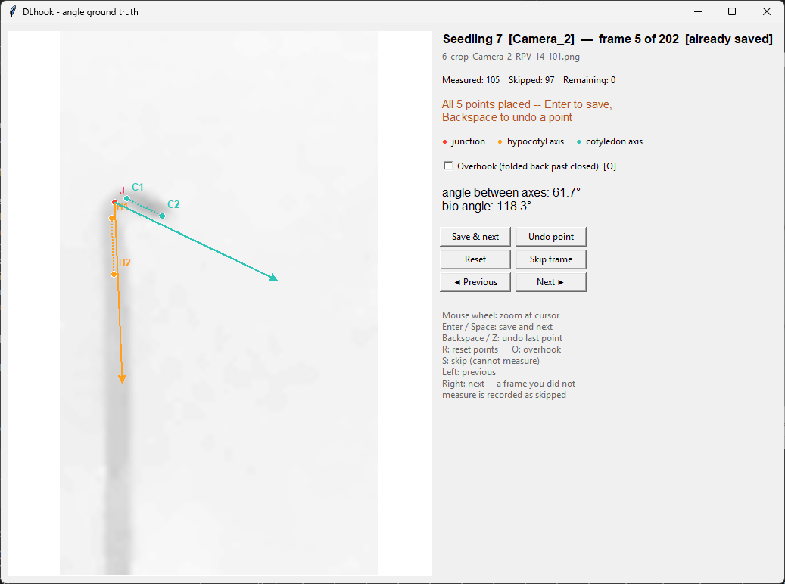

DLhook writes the plain (not super-resolved) crops to `data/images/` during *Start Analysis*, but wipes `data/` at startup and exit, so copy them to a folder of your own first if you want to annotate across sessions.

You can also annotate the crops used to train the four-class model (`data/crops/cropped_training_set/`, made by `multi/recrop_plates.py`). Its `manifest.csv` is picked up automatically, which keeps each series' seedlings apart (`crop_id` repeats across series) and records the source frame as `img_name`. Add `--split val` to keep only images the four-class model never trained on, which is the unbiased set to validate it with:

```bash
python -m ui.angle_annotator --folder data/crops/cropped_training_set --split val
```

For each frame, click five points (the mouse wheel zooms at the cursor, and the zoom is kept between frames of the same seedling):

1. the **junction** where the cotyledons meet the hypocotyl,
2. two points on the **hypocotyl** axis,
3. two points on the **cotyledon** axis.

Each axis is oriented automatically away from the junction, so the order of the two points on an axis does not matter. Tick **Overhook** if the hook has folded back past closed. Press `Enter` to save and move on, `Backspace` to undo a point and `S` (or `Right` / *Next*) to skip a frame you cannot measure. Moving on from a frame you did not measure records it as **skipped**, so the CSV tells "looked at and rejected" apart from "not reached yet"; `Left` goes back without recording anything. If a CSV predates this behaviour, `python -m ui.angle_annotator --folder data/crops/cropped_training_set --split val --mark-unrecorded-skipped` records every frame of the same sample that has no row as skipped (use the same `--folder`, `--split`, `--per-seedling` and `--seed` as the session) and exits without opening the window.

To compare your measurements with the pipeline, run `python -m multi.validate_angles`. By default it scores the two hand-measured sets no landmark model was trained on, pooled and per set: BerryBox v2 (`angle_berrybox_val.csv`) and round5 (`angle_round5.csv`, the older plate camera); `--truth` and `--crops` take paired, comma-separated lists for other sets. It runs the real pipeline with both backends on every crop of the seedlings you measured and prints the error per backend and per series (written to `multi/results/angle_validation/`).

Frames are a reproducible random sample (`--per-seedling`, `--seed`), grouped by seedling and shuffled within it so you cannot be guided by time order. `--min-frame N` leaves out each seedling's first N frames (its position in time order; the series frame number when the crops were cut with `recrop_plates.py --every-n 1`), so a sample can target the late frames, where the hook is measurable and opening: `python -m ui.angle_annotator --folder data/crops/cropped_round5 --min-frame 45 --per-seedling 0`. Results go to `data/annotations/angles/angle_ground_truth.csv` in the repository (change with `--out`). The file is saved after every frame, and the tool resumes where you stopped. `bio_angle` uses the same convention as the exported CSV (180 = closed, decreasing as the hook opens, above 180 = overhooked), and `seedling_id` and `frame` match the crop file names (plus `series` and `img_name` for the training crops), so the two can be joined directly.

## Correcting the segmentation (partial strokes)

The four-class model learned from the binary RootPainter models, so it inherits their mistakes: the binary hypocotyl often stops a few pixels below the hook, which shortens the measured hypocotyl, and on rigs the model never saw it splits the hypocotyl or misses cotyledon. `python -m ui.seg_annotator` lets you paint only those parts; everything you leave unpainted keeps the automatic label when the model is retrained.

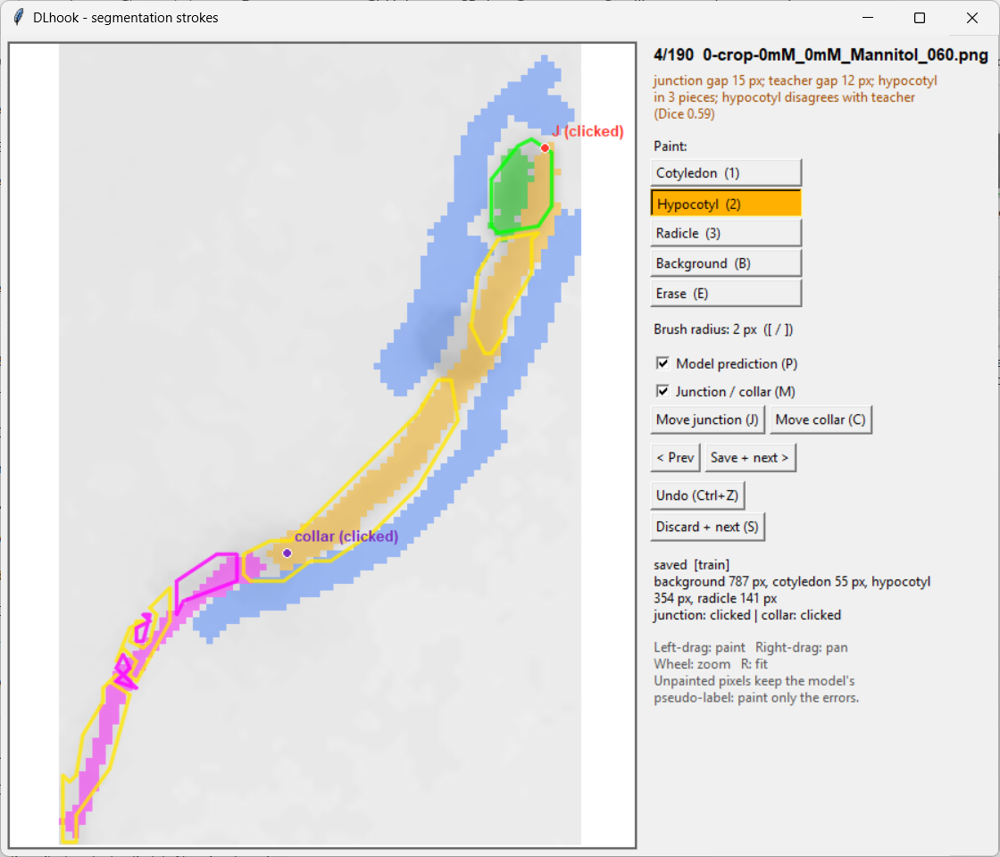

```bash
python -m multi.assess_seg_v2                        # ranks the crops that most need a stroke (writes tricky_crops.csv)
python -m ui.seg_annotator --folder data/crops/cropped_validation_set --queue multi/results/seg_v2_assessment/tricky_crops.csv
python -m ui.seg_annotator --folder data/crops/cropped_berrybox_val --queue multi/results/seg_v2_assessment/tricky_crops.csv --split val   # held-out test strokes
```

The model's current prediction is drawn as thin contours (`P` toggles them). Left-drag paints with the selected class: `1` cotyledon, `2` hypocotyl, `3` radicle, `B` background, `E` erase. `[` / `]` change the brush, `Ctrl+Z` undoes a stroke, right-drag pans and the wheel zooms. `Enter` / `→` save and go to the next crop, `←` goes back, `S` discards this crop's unsaved strokes. Typical strokes: hypocotyl through the hook up to the junction, background where the model invents tissue, cotyledon where it misses some. The tool resumes where you stopped.

The junction and the collar are drawn as reference points (`M` toggles them), so you can see where the hypocotyl should start and stop: your earlier clicks when the crop was annotated, otherwise the landmark model's reading (labelled `clicked` or `model`). If one is wrong, press `J` or `C` and click its true position. Corrections are saved with the strokes in `data/annotations/landmark_marks/<folder>.csv`, and landmark retraining uses them when the training config sets `landmarks.marks_dir: data/annotations/landmark_marks` (a corrected junction moves only the junction, the angle clicks are unchanged).

Strokes are saved in the RootPainter annotation format under `data/annotations/seg_strokes/<folder>/<class>/<train|val>/`, which the training pipeline's label merge already burns over the automatic labels (`multi/src/mask_merge.py`). `--split val` keeps a crop's strokes out of training, as a human-labelled test set on new rigs. `data.split_level: seedling` in a training config keeps every frame of a plant on the same side of the train/validation split.

Retraining and scoring:

```bash
python -m multi.build_seg_v2_dataset                 # automatic labels + your strokes for every crop folder -> data/crops/cropped_seg_v2
python multi/build_patch_index.py --config multi/configs/training_config_v2.yaml
python multi/train_unet_multiclass.py --config multi/configs/training_config_v2.yaml
python -m multi.assess_seg_v2 --score-strokes weights/multiclass/dlhook_4class_v1.pt+multi/results/models_4class_v2/best.pt
```

**What this gave (`dlhook_4class_v2.pt`, 14 October 2026).** 178 crops with strokes (validation set) plus about 6,300 crops from seven folders, warm-started from v1. On 60 held-out BerryBox v2 crops (42 plants) painted with `--split val`, hypocotyl recall rose from 0.90 to 0.94 (per plant 0.80 to 0.90; better on every rig) and cotyledon precision and recall from 0.54 / 0.82 to 0.59 / 0.85; hypocotyl precision fell from 0.72 to 0.70, mostly radicle called hypocotyl, which the GUI does not use. Hypocotyl length on 201 held-out frames, against the clicked junction → H2 → collar line, has a median ratio of 1.00, against 0.95 for the binary `hypocot_v5` mask used before (short by more than 10%: 5% of frames against 32%). On the 441 crops annotated in RootPainter on the older rigs, hypocotyl recall rose (0.93 to 0.97) while cotyledon recall fell (0.68 to 0.64). Reports: `multi/results/seg_v2_assessment/`.

## Measuring the hypocotyl traits by hand

`python -m ui.trait_annotator` collects hand measurements of the length, curvature and diameter, and `python -m multi.validate_traits` scores the pipeline against them.

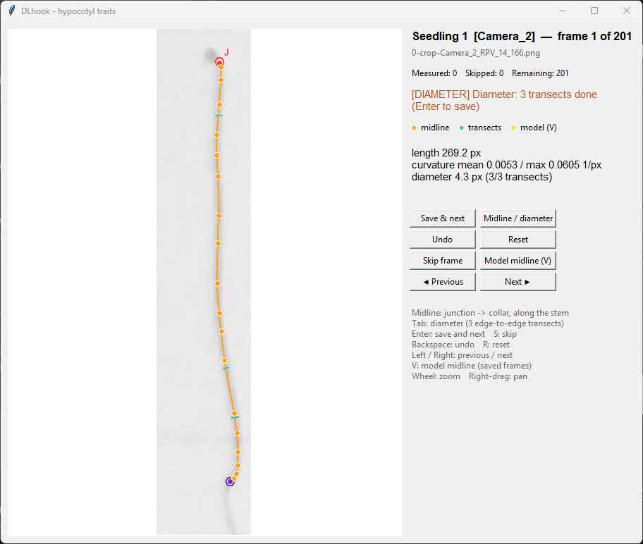

**Result on 200 BerryBox v2 frames.**
- **Length is reliable.** With the junction and collar placed by hand, it is off by 3.5 px on average on a median of 182 px (r = 1.00). With the landmark model's junction and collar, as exported, the error is 9.8 px.
- **Diameter is reliable since the fix.** It read about 2 px too wide (the mask runs about 1 px past each edge), so the transects are now measured on the mask shrunk by 1 px. The error is now 0.5 px on a hand median of 4.9 px (bias −0.3 px, r = 0.69).
- **Curvature is not validated.** It reads about twice the hand value, but the hand value is only a rough estimate: a median of 11 clicks along a 182 px hypocotyl smooths out the bends. The two rank seedlings the same way (r ≈ 0.8).

```bash
python -m ui.trait_annotator                                   # BerryBox v2 val (no model trained on it), frames with a clicked junction and collar
python -m multi.validate_traits --truth data/annotations/traits/cropped_berrybox_val.csv --binary
```

Per frame, click along the middle of the hypocotyl from the **junction** to the **collar** (more points in the hook, where it bends), then press `Tab` and click three **transects** across the stem, edge to edge, spread along it. The junction and collar you clicked earlier are shown as hollow circles to guide you. Length and curvature come from a smooth curve through your clicks, computed the same way as the pipeline's midline; the diameter is the median of the three transects. The model's midline stays hidden while you measure; `V` shows it once the frame is saved. `Enter` saves and moves on, `S` skips a frame that cannot be measured, `Backspace` undoes, `R` resets. Results go to `data/annotations/traits/<folder>.csv`, saved after every frame; the tool resumes where you stopped.

`validate_traits` reports, per trait, the bias, mean absolute error, median ratio, correlation and share of frames off by more than 10%, twice: with the junction and collar taken from your midline (the mask alone) and from the landmark model (what the GUI exports). `--proxy` runs the earlier check that needs no hand traits (length against the clicked junction → H2 → collar line, every annotated folder).

The midline is traced on the piece of the hypocotyl mask the junction belongs to: the piece nearest the junction, joined to further pieces less than 10 px away (a hypocotyl split in two), so a neighbouring seedling in the crop is not measured instead.

## Collar, root and germination onset by hand

`python -m ui.root_annotator` re-opens the frames you measured with the angle annotator and asks for the other end of the seedling: click the **collar**, then one point on the **root** (`N` = no radicle yet, `S` = cannot tell). `python -m ui.germination_annotator` shows each seedling's whole timeline: press `G` on the first frame with a visible radicle (`F` = already visible in the first frame, `X` = none, `S` = skip). Both save after every decision and resume where you stopped.

```bash
python -m ui.root_annotator --folder path/to/crops --angles data/annotations/angles/angle_mine.csv     # writes angle_mine_root.csv
python -m ui.germination_annotator --folder path/to/crops --out data/annotations/germination/germination_mine.csv
```

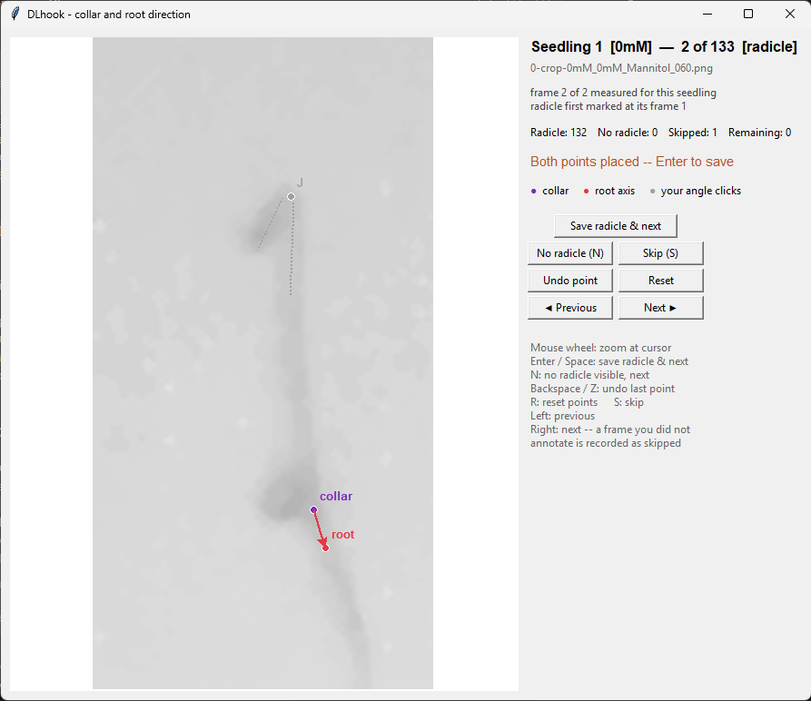

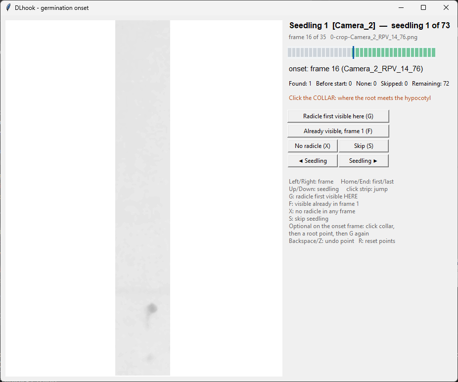

## Reviewing earlier annotations

`python -m ui.angle_reviewer` re-opens frames you already measured, to fix a mistake or to mark a frame where no angle can be measured, without touching the original CSV. Decisions go to `<csv>.review.csv`, and the training and scoring code applies it on top of the original (`utils/angle_review.py`). `--errors <csv> --only-errors` limits the session to a list of suspect frames.

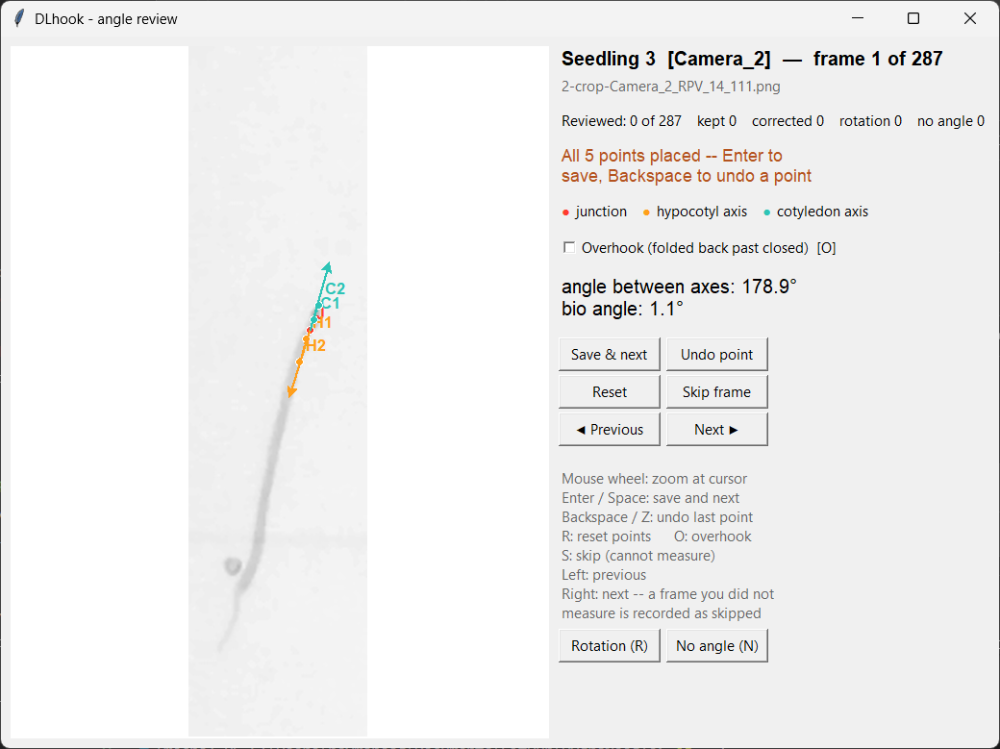

```bash
# measured frames, the ones the model disagrees with most first
python -m multi.validate_landmarks --truth data/annotations/angles/angle_landmarks_train.csv --folder data/crops/cropped_training_set --checkpoints weights/landmarks/dlhook_landmarks_a.pt+weights/landmarks/dlhook_landmarks_b.pt+weights/landmarks/dlhook_landmarks_c.pt --per-crop-out multi/results/review_errors/train
python -m ui.angle_reviewer --folder data/crops/cropped_training_set --csv data/annotations/angles/angle_landmarks_train.csv --errors multi/results/review_errors/train/<per-crop CSV written above>

# frames you skipped after the seedling germinated (before germination there is nothing to measure)
python -m ui.angle_reviewer --folder data/crops/cropped_training_set --csv data/annotations/angles/angle_landmarks_train.csv --skipped --germination data/annotations/germination/germination_train.csv
```

Each frame opens with your five clicks. `Enter` keeps them (or saves five you re-clicked after `X`), `R` marks **rotation** (the cotyledons pass in front of or behind the hypocotyl, so no angle is measured), `N` marks **no angle** for another reason, `S` / `Right` moves on without recording anything. The tool resumes where you stopped.

## Training a landmark head from your annotations

The same clicks train the landmark head: it finds the cotyledon/hypocotyl **junction** and the two axis directions directly, which removes the direction ambiguity of a fitted ellipse. The landmark angle is always `180 - theta`. The network has no overhook output, because overhooked frames sit only a few degrees past 180° (median 6.5°), below the repeatability of the clicks themselves (your own repeat measurements differ by about 4° at the median, and the overhook call by 8%); the exported `overhook_flag` is a geometric test on the reading and does not change the angle.

**1. Annotate training frames** (never reuse your test set):

```bash
python -m ui.angle_annotator --folder data/crops/cropped_training_set --split train --out data/annotations/angles/angle_landmarks_train.csv --per-seedling 10 --seed 1
```

Aim for at least 400 measured frames spread over the series. Click the same way every time, because the model learns exactly what you click:

- **junction**: the joint where the cotyledons meet the hypocotyl;
- **hypocotyl** points: on the midline of the stem just below the junction;
- **cotyledon** points: on the midline of the cotyledon. The **first** click is its **base**, at the junction, and the **last** click is its **tip** (once the two cotyledons have separated, the midpoint between the two tips). The model reads the cotyledon direction as base to tip, which is what tells an open hook from a closed one;
- the **Overhook** tick is still recorded in the CSV but ignored by landmark training and by `multi/validate_angles.py` (which scores against `180 - theta`; `--keep-overhook` restores the raw angle).

`--split train` keeps your frames out of the segmentation validation split, and the training code drops any validation-split crop it finds in the main CSV anyway. `data/annotations/angles/angle_ground_truth.csv` is no longer a test set: the shipped landmark recipe trains on it and on the other former validation sets (`landmarks.extra_sources`). The independent test sets are BerryBox v2 (`angle_berrybox_val.csv`) and round5 (`angle_round5.csv`); keep them out of `extra_sources`.

**2. Fine-tune** from the shipped four-class checkpoint (adds a landmark head, keeps the segmentation):

```bash
python multi/train_unet_multiclass.py --config multi/configs/training_landmarks.yaml
```

The first epochs train only the new head, then the whole network (`landmarks.head_only_epochs`). The best epoch is chosen by the angle error on held-out annotated seedlings, among epochs whose segmentation score stays above `landmarks.min_mean_fg_dice`. Checkpoints go to `multi/results/models_landmarks/`.

The previous ensemble was trained with `multi/configs/training_landmarks_all_{a,b,c}.yaml`: every annotated set, the landmark head only (the segmentation stays the four-class model's), three seeds. The default one adds the measurable output in two steps: `training_landmarks_all_{a,b,c}_m.yaml` trains that output alone on a previous member, then `training_landmarks_all_{a,b,c}_mt.yaml` retrains the landmark trunk and heads with it (skipped frames are its negatives). `python -m multi.validate_measurable --fit` sets the gate threshold on the held-out seedlings, and `python -m multi.validate_measurable` scores the gate on BerryBox v2.

**3. Score it on your held-out ground truth**, next to the current pipeline:

```bash
python -m multi.validate_angles --backends multiclass --landmark-checkpoint multi/results/models_landmarks/best.pt
```

The landmark readings appear as `landmark` (per frame) and `landmark_recon` (after reconstruction). Several checkpoints joined by `+` are scored as an ensemble.

## Advanced

**Debug Mode** (checkbox, off by default) logs what the germination detector measured for each seedling.

**Console output.** DLhook logs through Python's `logging` module. `DLHOOK_LOG_LEVEL=DEBUG python main.py` also shows the per-frame details (contours, angles); `DLHOOK_LOG_LEVEL=WARNING` keeps only problems.

**Where files go.** Weights are found relative to the repository, so `python <path-to-DLhook>/main.py` works from any directory. The session's scratch files (crops, mask dumps) go to `data/` inside the repository, or to `DLHOOK_DATA_DIR` when that is set; they are wiped at start and exit.

**Running a series without the GUI.** With a boxes file saved from the GUI, `multi/run_series.py` runs the same code as *Start Analysis* and writes the export CSV, a summary, and one figure per seedling (angle, junction–collar distance and collar deviation, with unreadable and flagged frames marked):

```bash
python -m multi.run_series --images example_data/Plate_1_Old --boxes example_data/Plate_1_Old/crop_boxes.json --out multi/results/series_Plate_1_Old
```

**Dumping masks.** Masks are kept in memory. To also write them to `data/predict/` as PNGs:

```bash
DLHOOK_DUMP_MASKS=1 python main.py
```

**Tests.** About 570 tests cover the angle reconstruction, readability gate and time-series checks, capture-time parsing, germination detection, crop-box layout, segmentation backends and the `multi/` training pipeline. No GPU or image data is needed:

```bash
pytest
```

> [!CAUTION]
> The `torchvision.transforms.functional_tensor` shim at the top of `seedling_measurement.py` is load-bearing. It keeps `basicsr` / `realesrgan` importable on current torchvision versions — removing it breaks startup.

---

## Status & known limitations

DLhook v0.3.0 is a **pre-release**. It is usable and in active development, but the following are known and unresolved:

- **Germination time zero is approximate.** On 83 BerryBox v2 seedlings (a rig the detector was never fitted on) the onset is exact on 43% and within one frame on 72%; misses are more often late (34 seedlings) than early (13). Check time zero in the analysis window for your own material.
- **Super-resolution is opt-in and adds a tiny fraction of detail** (`DLHOOK_SUPERRES=1`, CUDA only). The 4× output is immediately resampled back to native size, so there is nothing extra to zoom into.
- **Hypocotyl curvature is experimental.** Length and diameter are validated against hand measurements (200 BerryBox v2 frames: length within 3.5 px with the hand junction and collar, 9.8 px with the model's; diameter within 0.5 px); curvature is not (see the output table).
- **The angle has been tested on new plants, not on a new rig.** Every test plant (BerryBox v2: 15.0° mean error; round5: 27.0°; pooled 16.8°, median 6.9°) comes from a camera setup the models were trained on. Expect a larger error on a very different setup, and check a few frames by hand.
- **Open and young hooks are the weak cases.** Open hooks are read about 12° too closed and closed or overhooked ones about 9° too open; on tight young hooks the model sometimes reads the cotyledon axis mirrored (23 of the 38 readings off by more than 30°), which the series filter removes only when it lasts a few frames.
- **One annotator.** All hand measurements behind these numbers come from one person; their repeat error is about 4 to 5°.
- **The angle is slow on CPU.** Each frame costs three landmark networks with flip averaging (six forward passes).
- **The time-series thresholds were set on annotated series** (15 px collar jump, 5 px junction drop). Very different magnifications may need other values (`utils/landmark_temporal.py`).
- **GPU and CPU results are not bit-identical** — roughly 1 pixel in 86,000 (0.001%) can differ.

---

## Licence

DLhook is released under the **GNU General Public License v3.0** — see [`LICENSE.txt`](LICENSE.txt).

The segmentation network architecture and the trained weights derive from [RootPainter](https://github.com/Abe404/root_painter) (Copyright © 2019, 2020 Abraham George Smith), which is GPLv3; DLhook is therefore GPLv3 as well.

---

## Citation

Please cite this repository while we work on the manuscript describing the method (see also [`CITATION.cff`](CITATION.cff)):

> David Radianu, Sara Raggi, Sandeep Yadav, Hemamshu Ratnakaram, Siamsa Doyle, Stéphanie Robert\*, Adrien Heymans\* (2025). DLhook: High-throughput apical hook phenotyping of dark-grown Arabidopsis thaliana seedlings. v0.3.0.

Pre-trained weights: Radianu D, Raggi S, Yadav S, Ratnakaram H, Doyle S, Robert S, Heymans A (2026). DLhook pre-trained weights v1.0. Zenodo. [doi:10.5281/zenodo.23531884](https://doi.org/10.5281/zenodo.23531884).
